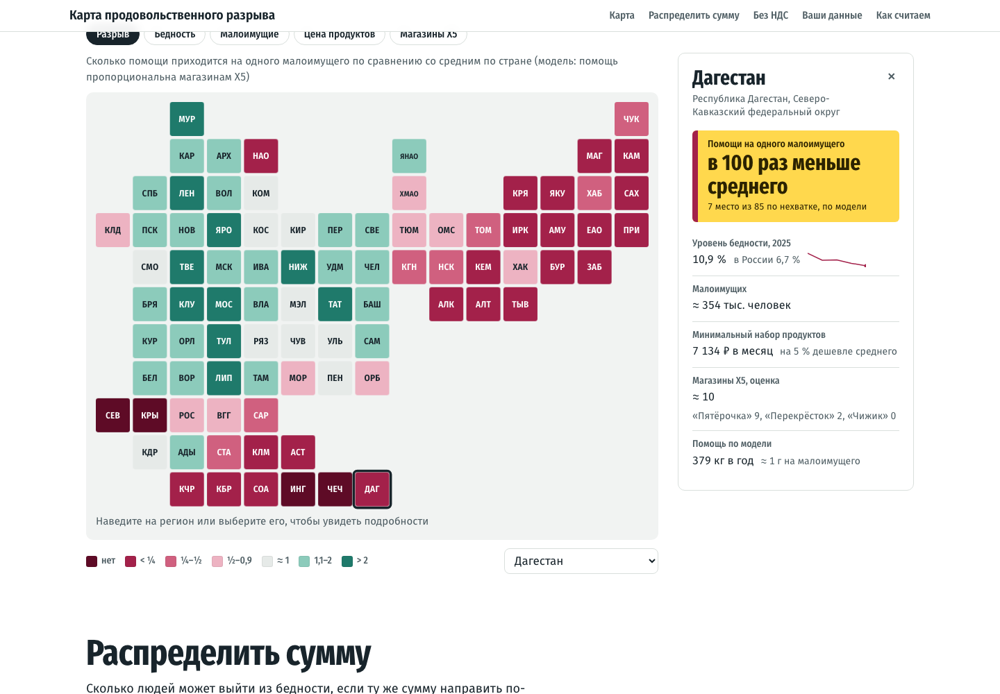
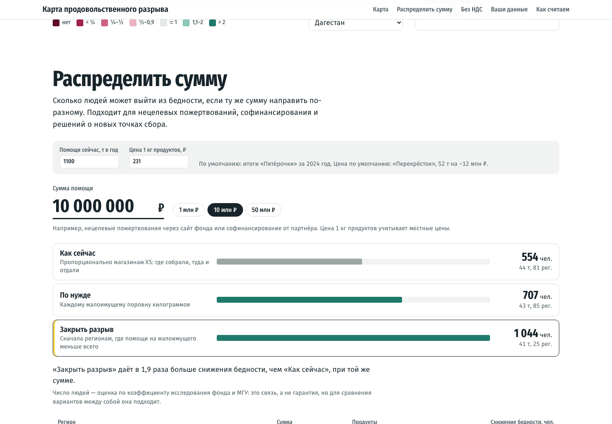

# Карта продовольственного разрыва

Открытый инструмент для благотворительного фонда X5 «Выручаем»: где в России больше всего малоимущих и меньше всего продуктовой помощи, и куда отправить следующий килограмм, чтобы он сильнее всего снизил бедность.

**Демо:** https://svpeditor.github.io/food-gap-map/ (работает в браузере, установка не нужна)



## Зачем это фонду

Фонд вместе с экономическим факультетом МГУ показал на данных Росстата по 81 региону за 30 лет: +1 кг продуктовой помощи на душу в год связан со снижением уровня бедности на 20,55 %. Из этого следует, что важно, **куда** попадает помощь. Сейчас её собирают в магазинах X5, а платформа продпомощи позволяет «направлять помощь точечно в те регионы, где она была собрана». Магазинов X5 меньше всего как раз там, где бедность выше:

- в десяти регионах с самой высокой долей бедных около 166 магазинов X5, это 0,6 % сети; в Ингушетии и Чечне, по данным OpenStreetMap, нет ни одного;
- если помощь распределена как магазины, в 33 регионах на одного малоимущего приходится как минимум вдвое меньше помощи, чем в среднем, и там живёт 38 % малоимущих страны;
- тот же объём, распределённый по числу малоимущих, по модели МГУ даёт в 1,3 раза больше снижения бедности.

Публичного инструмента, который сводит нужду и присутствие помощи на одной карте, нет ни у фонда, ни у X5, ни в России вообще. Ближайший аналог — Map the Meal Gap фонда Feeding America в США.

### Пять задач, которые закрывает инструмент

1. **Куда направить нецелевые деньги.** Пожертвования через сайт фонда, софинансирование партнёров и бюджет акций можно распределить тремя способами: «как сейчас», «по нужде», «закрыть разрыв». Сразу видно, сколько людей может выйти из бедности при каждом способе, и это можно скачать в CSV.
2. **Аргумент для законопроекта о НДС.** Сценарий «без НДС» считает дополнительные тонны помощи и эффект по регионам и собирает готовую справку для письма или выступления (рост минимум на 40 % и издержки 8–16 ₽ на 100 ₽ взяты из исследования МГУ).
3. **Где искать партнёров и открывать точки сбора.** Регионы с высокой бедностью и без магазинов X5 видны сразу: туда нужны НКО-партнёры, банки еды и онлайн-сбор.
4. **Своя статистика вместо модели.** Выгрузку платформы продпомощи (CSV или Excel, «регион; кг») можно загрузить, и карта покажет фактический разрыв. Файл обрабатывается в браузере и никуда не отправляется. Регион распознаётся по названию, коду ISO, ОКАТО или городу-центру.
5. **Публичная коммуникация.** Ссылка сохраняет выбранный регион, слой и расчёт, поэтому её можно отправить партнёру или журналисту. Карточка региона показывает факты из пресс-релизов X5 со ссылками.

### Как это внедрить

- Сайт статический: одна страница и один JSON с данными. Его можно разместить где угодно или встроить в кабинет платформы продпомощи.
- Расчётная часть (`src/model`) состоит из чистых функций TypeScript без зависимостей и покрыта тестами. Её можно перенести в бэкенд платформы как есть.
- Данные обновляются одной командой из официальных источников (см. ниже). Новый год Росстата подтягивается без правки кода.

## Что на странице

- **Карта** 85 субъектов РФ, где все регионы одного размера, поэтому Москва и Ингушетия видны наравне с Якутией. Слои: разрыв, бедность, малоимущие, цена минимального набора продуктов, магазины X5. Клик по региону открывает карточку со всеми цифрами, источниками и местом в рейтинге.
- **Распределить сумму:** три способа распределения, сравнение эффекта, таблица по регионам, CSV.

  

- **Без НДС:** ползунок роста объёма, эффект при нынешней географии и при распределении по нужде, текст справки.
- **Ваши данные:** загрузка выгрузки, шаблон, ручное сопоставление нераспознанных строк, пример на реальных цифрах из пресс-релизов X5.
- **Как считаем:** формулы, источники, ограничения.

## Данные

| Что | Источник | Период |
|---|---|---|
| Доля населения с доходами ниже границы бедности | Росстат, [ЕМИСС 62063](https://fedstat.ru/indicator/62063) | 2021–2025 |
| Численность населения (среднегодовая) | Росстат, [ЕМИСС 31556](https://fedstat.ru/indicator/31556) | 2024 |
| Стоимость минимального набора продуктов | Росстат, [ЕМИСС 31481](https://fedstat.ru/indicator/31481) | 2025, среднее за 12 месяцев |
| Магазины «Пятёрочка», «Перекрёсток», «Чижик» | © участники OpenStreetMap (ODbL) через Overpass API, границы [geoBoundaries](https://www.geoboundaries.org/) (ODbL), пересчёт на официальный итог X5 на 31.12.2025 | 11.2026 |
| Коэффициент 20,55 %, рост +40 % без НДС, 8–16 ₽ на 100 ₽ | [пресс-релиз фонда «Выручаем» и МГУ](https://esg.x5.ru/media/pdfs/040626_ru.pdf) | 06.2026 |
| Объём помощи по умолчанию 1 100 т в год | [итоги «Пятёрочки» за 2024 год](https://esg.x5.ru/media/pdfs/28025_ru.pdf) | 2024 |
| Цена 1 кг ≈ 231 ₽ | [«Перекрёсток»: 52 т на ~12 млн ₽](https://esg.x5.ru/media/pdfs/100826_ru.pdf) | 1 пол. 2026 |
| Региональные объёмы «Корзины доброты» и фудшеринга | пресс-релизы X5 ([1](https://esg.x5.ru/media/pdfs/080825_ru.pdf), [2](https://esg.x5.ru/media/pdfs/250807-pyatyorochka-vtroe-uvelichila-obyomyi-pomoschi-po-fudsheringu_ru.pdf)) | 1 пол. 2025 |

Уровень бедности в России в 2025 году: 6,7 % (без учёта новых субъектов: так Росстат публикует ряд).

### Модель

- Малоимущие в регионе = доля бедных × население.
- Помощь «как сейчас» (пока фонд не загрузил выгрузку) = общий объём × доля региона в магазинах X5.
- **Разрыв** = кг помощи на малоимущего в регионе / то же по стране.
- Эффект: число малоимущих × (1 − e^(−0,2055 × кг на душу)). Это коэффициент МГУ, прочитанный как полуэластичность. На реальных объёмах эффект килограмма пропорционален доле бедных в регионе.
- Цена килограмма в регионе = базовая цена × (стоимость набора в регионе / по России).

Коэффициент МГУ описывает статистическую связь, а не доказанную причинность. Числа людей годятся, чтобы сравнивать варианты между собой, а не для отчёта о результате. Это написано и на странице.

### Ограничения

- Росстат публикует уровень бедности по 85 субъектам, без учёта ДНР, ЛНР, Запорожской и Херсонской областей. Карта показывает эти 85.
- OpenStreetMap неполон, поэтому модель использует долю региона в сети и пересчитывает её на официальные итоги X5 по каждой сети.
- Модель «помощь там, где магазины» — упрощение до загрузки фактических данных фонда.

## Запуск и проверка

```bash
npm ci
npm run dev          # локальный сервер
npm test             # тесты модели, распознавания регионов, разбора файлов
npm run build        # статическая сборка в dist/

cd data
pip install certifi pytest
python -m pytest -q  # сборка public/data/regions.json и проверки данных
```

Обновить сырые данные (нужен российский IP для fedstat.ru):

```bash
cd data
python emiss.py 62063               # бедность по регионам
python emiss.py 31556 2024          # население
python emiss.py 31481 2025,2026     # стоимость минимального набора продуктов
rm raw/osm_x5_shops.json && python osm_x5.py   # магазины X5 из OpenStreetMap
python build.py
```

## Устройство репозитория

```
data/            загрузчики (ЕМИСС, OSM), справочник регионов, факты из пресс-релизов, сборка JSON, тесты
data/raw/        сохранённые ответы ЕМИСС (SDMX) и точки OSM: расчёт воспроизводим без сети
public/data/     regions.json, который читает сайт
src/model/       расчёты: покрытие, разрыв, эффект, распределение, сценарий НДС
src/io/          распознавание регионов, разбор CSV/XLSX, экспорт CSV
src/ui/          карта, карточка региона, калькуляторы, загрузка, методика
docs/            дизайн и план
```

## Конкурс

Сделано для конкурса X5 Tech «Вайбкодинг добрых дел» вместе с Claude Code. Сессии работы над проектом шли с виджетом X5 Клуба «Сколько съел твой Клод?».

Данные Росстата открыты; данные OpenStreetMap и geoBoundaries распространяются по лицензии ODbL с указанием авторства. Права на код принадлежат автору.
